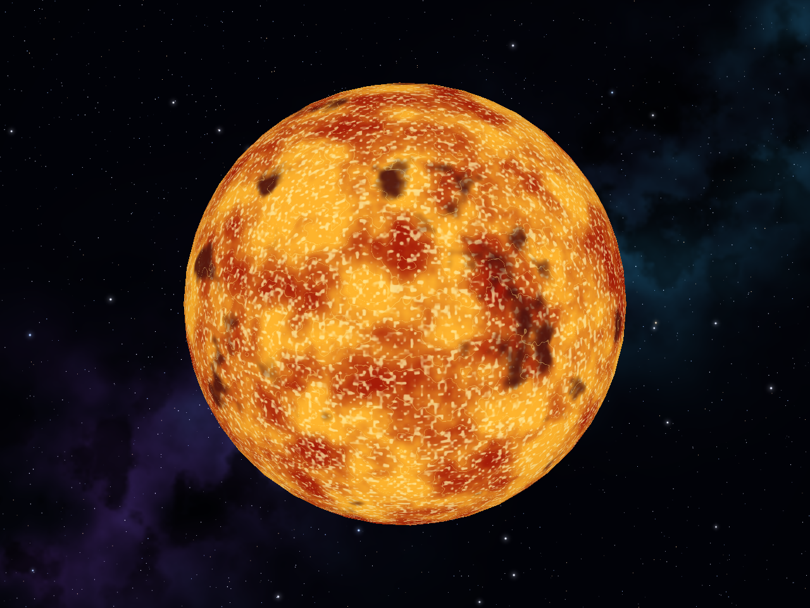
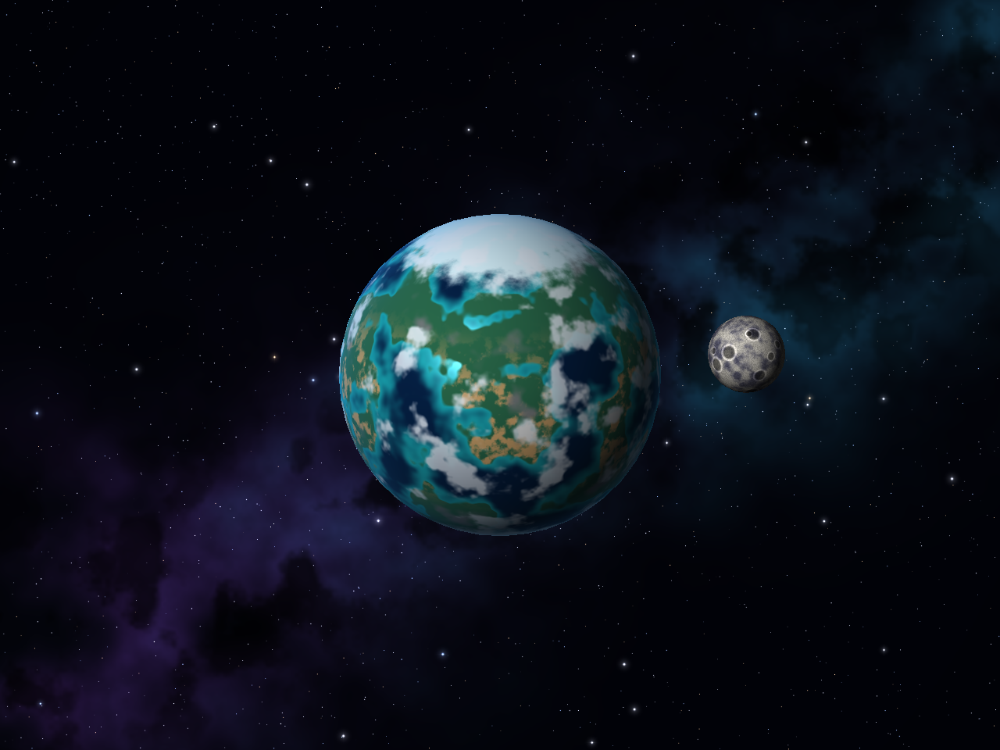
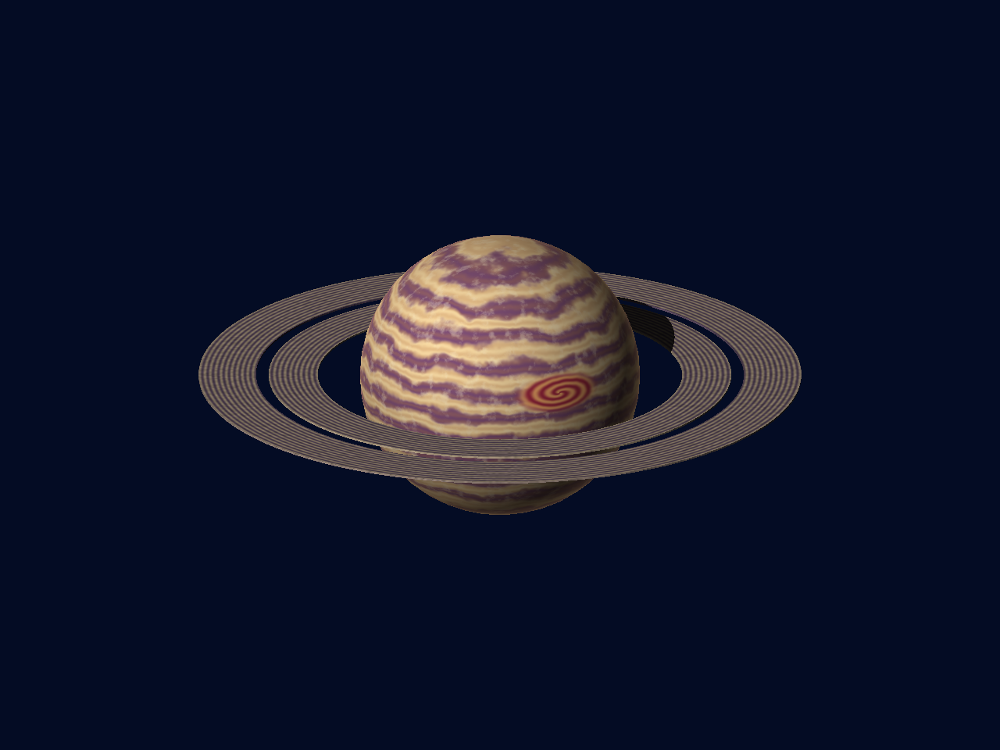

# Gráficas — Laboratorio 5

Software renderer en Rust con shaders procedurales calculados por fragmento.
Los colores se generan con fórmulas, value noise 3D y fBm de cuatro octavas;
no se utilizan texturas, materiales de Blender ni colores de vértice.

## Ejecutar

Requiere Rust/Cargo y un entorno de escritorio para la ventana de `minifb`.

```sh
cargo run --release
```

Los OBJ se cargan desde `models/` usando la ruta del proyecto, aunque ejecutes
el programa desde otro directorio. La escena inicia pausada para inspeccionar
los shaders; presiona **Espacio** para activar la animación.

| Tecla | Acción |
| --- | --- |
| `1` | Helios: estrella |
| `2` | Thalassa: planeta rocoso con luna |
| `3` | Aureon: gigante gaseoso con anillos |
| Flechas | Orbitar la cámara |
| Espacio | Animar o pausar rotación, evolución de plasma/nubes y órbita lunar |e
| `E` | Mostrar u ocultar luna y anillos; reajusta el encuadre |
| `H` | Alternar superficie y malla en modo holograma |
| `R` | Reiniciar cámara y tiempo de la escena activa |
| `S` | Guardar la vista actual en `screenshots/<cuerpo>.png` |
| Esc | Cerrar |

## Diseños y capas de color

Las capas se combinan antes de la iluminación por fragmento. Las normales de
las esferas se calculan a partir de la posición local normalizada; no se necesita
leer normales ni coordenadas UV del OBJ. Los patrones permanecen ligados al
modelo cuando gira o cambia la cámara.

| Cuerpo | Capa 1 | Capa 2 | Capa 3 | Capa 4 | Efectos adicionales |
| --- | --- | --- | --- | --- | --- |
| Helios | Plasma rojo/naranja con fBm | Granulación caliente | Manchas con penumbra | Filamentos brillantes | Emisión simulada sin luz externa y oscurecimiento hacia el limbo |
| Thalassa | Océanos y costas turquesas | Continentes, desiertos y montañas | Casquetes polares | Nubes procedurales | Reflejo del agua, iluminación suave y borde atmosférico |
| Aureon | Bandas latitudinales turbulentas | Corrientes finas | Nubes multiescala | Gran tormenta ovalada | Borde cálido y anillos con sombra del planeta |

La estrella simula su propia emisión mediante el color; no ilumina físicamente
otras escenas ni usa bloom. Cada escena tiene una luz direccional fija.
Los efectos atmosféricos también son mezclas de color en la superficie.

### Fondo del cosmos

El fondo combina una franja galáctica diagonal, nebulosas violetas y turquesas,
polvo oscuro y estrellas blancas, azuladas y cálidas con distintos tamaños.
Las más brillantes tienen un halo suave y pequeños destellos.

Todo se genera mediante ruido y fórmulas en `src/cosmos.rs`, con una semilla fija.
Se calcula una vez al iniciar y se conserva como fondo del framebuffer, sin leer
imágenes ni recalcular las nebulosas en cada cuadro. Permanece fijo en pantalla
al orbitar la cámara, animar o cambiar de cuerpo; no simula un cielo esférico.
Al limpiar el framebuffer se restaura el fondo y se reinicia el z-buffer, para
que los planetas, la luna y los anillos siempre puedan dibujarse delante.

### Helios



### Thalassa y su luna



La luna usa `models/luna.obj`, tiene escala 0.24 y orbita a 1.60 unidades del
centro del planeta. Su shader combina regiones oscuras, grano y cráteres
calculados por distancia sobre la esfera. Los cráteres afectan solo el color.

### Aureon y sus anillos



Los anillos usan `models/anillos.obj` como objeto independiente. El shader calcula
bandas por distancia al centro y grano procedural. Una prueba rayo-esfera produce
la sombra del gigante sobre ellos. Todos los objetos comparten el mismo z-buffer,
por lo que sus partes delanteras y traseras se ocultan según la profundidad.

## Capturas reproducibles y comprobaciones

Para regenerar las tres capturas con cámara inicial, extras y tiempo cero,
sin abrir una ventana:

```sh
cargo run --release -- --screenshots
```

Este comando sobrescribe los tres PNG del README. La exportación PNG es solo una
salida del renderer; las imágenes no se leen para sombrear los planetas.

```sh
cargo test
cargo fmt --all -- --check
cargo clippy --all-targets
```

Las pruebas verifican interpolación y profundidad de fragmentos, continuidad del
ruido, variedad de colores, emisión de la estrella, cambios por animación,
renderizado de las escenas, modo de malla de los planetas y composición del fondo
sin alterar el color ni la profundidad de los cuerpos.

## Código

- `src/app.rs`: ventana, controles y exportación de capturas.
- `src/scene.rs`: carga de modelos, transformaciones, cámara y dibujo de objetos.
- `src/shaders.rs`: ruido y shaders de los cuerpos, luna y anillos.
- `src/cosmos.rs`: generación procedural del campo de estrellas y las nebulosas.
- `src/triangle.rs`: rasterización e interpolación de posiciones locales.
- `src/framebuffer.rs`: color, profundidad y escritura de PNG.
- `src/main.rs`: entrada y configuración general del laboratorio.
