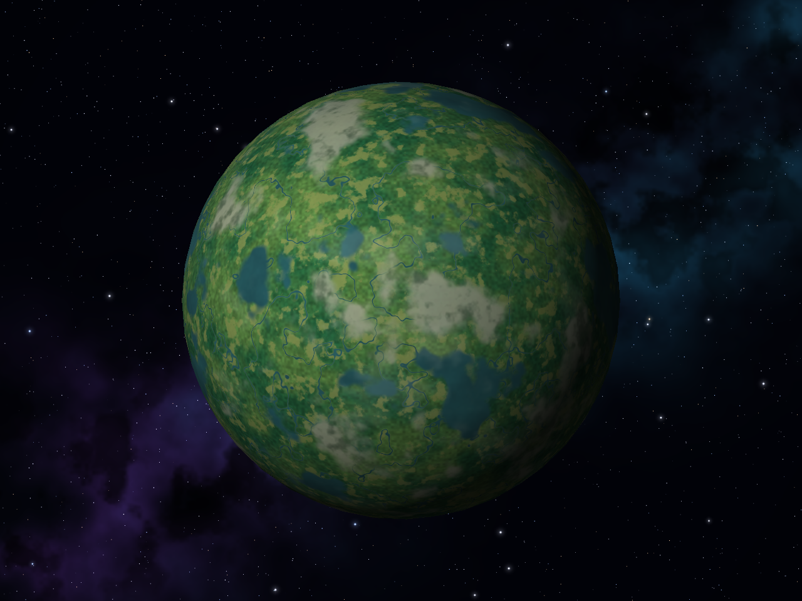
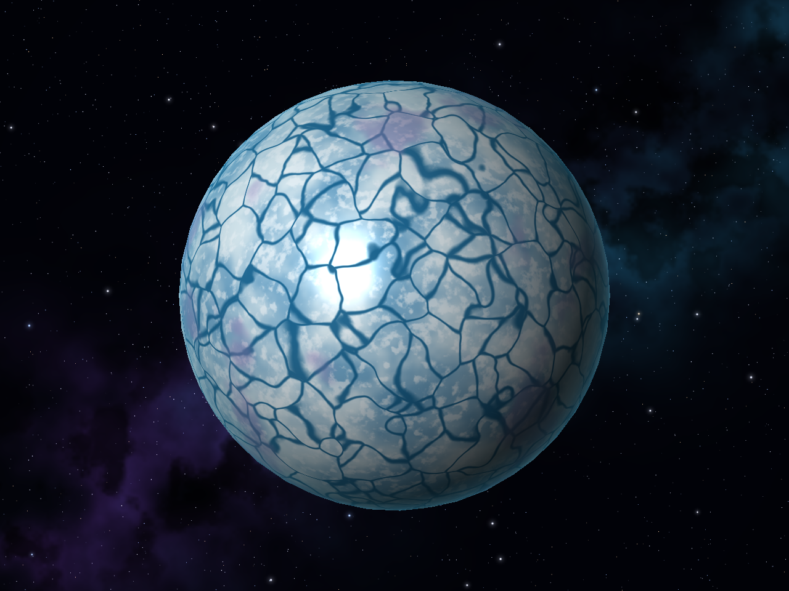
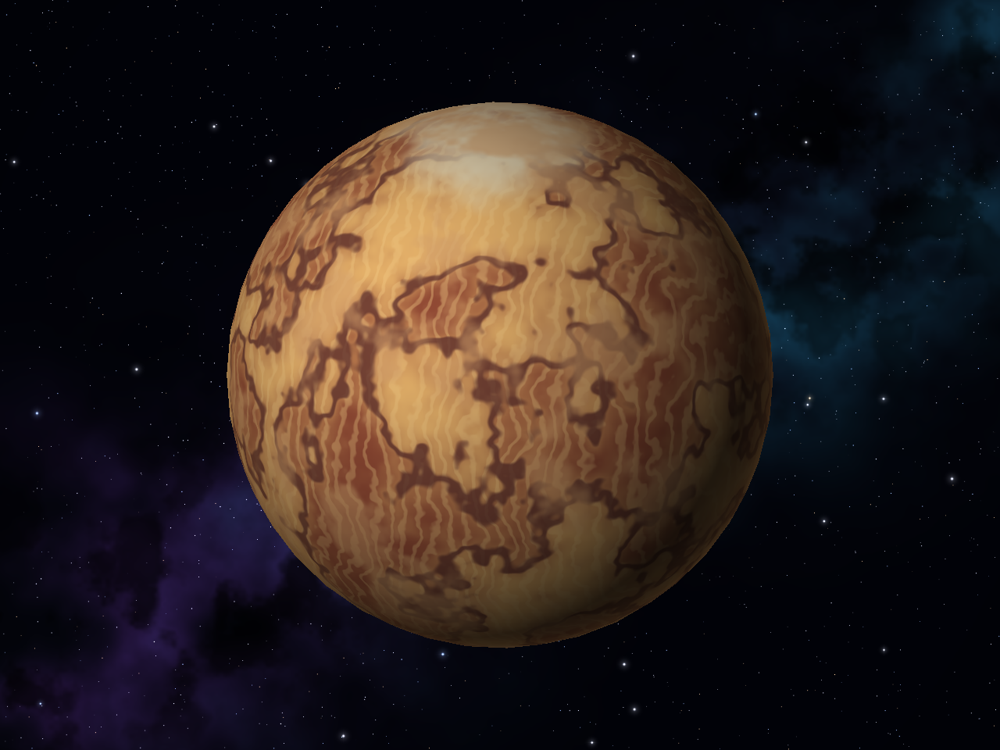

# Gráficas por Computadora — Laboratorio 5 Shaders

Software renderer en Rust con shaders procedurales calculados por fragmento.
Los colores se generan con fórmulas, value noise 3D y fBm de cuatro octavas;
no se utilizan texturas, materiales de Blender ni colores de vértice.

## Librerías Utilizadas

| Librería | Descripción e Importancia |
| :--- | :--- |
| `minifb` | Crea la ventana, recibe la entrada del teclado y muestra en pantalla el arreglo de píxeles del framebuffer. |
| `nalgebra-glm` | Proporciona vectores `Vec3` y operaciones matemáticas para transformar vértices, calcular normales, iluminar superficies y controlar la cámara orbital. |
| `png` | Codifica el framebuffer como imágenes PNG para guardar las capturas de los seis cuerpos celestes e incluirlas en este README. |

## Guía de Ejecución

### Prerrequisitos

- **Rust y Cargo:** Tener instalado [Rust](https://rustup.rs/) en una versión estable compatible con la edición 2024 del proyecto.
- **Git:** Tener Git instalado para clonar el repositorio.
- **En Windows:** Usar el toolchain `x86_64-pc-windows-msvc` junto con **Visual Studio C++ Build Tools** y el SDK de Windows. Instalar únicamente el toolchain de Rust no sustituye las herramientas de compilación de C++. `minifb` utiliza las APIs nativas de Win32, por lo que no necesita SDL2.
- **En macOS:** Contar con un entorno gráfico activo y las herramientas de línea de comandos de Xcode.
- **En Linux:** Contar con un entorno gráfico activo y las herramientas de compilación y bibliotecas de desarrollo de X11/Wayland que utilice `minifb`. En Debian/Ubuntu, según la configuración del sistema, pueden ser necesarios estos paquetes:

  ```bash
  sudo apt install build-essential cmake pkg-config libx11-dev libxkbcommon-dev libwayland-dev libwayland-cursor0
  ```

Cargo descarga y compila las librerías de Rust declaradas en `Cargo.toml`.
Los modelos OBJ necesarios ya están incluidos en `models/`; no necesitas Blender
para ejecutar el laboratorio.

---

### En Windows (PowerShell / CMD / Windows Terminal)

1. Abre **PowerShell**, **CMD** o **Windows Terminal** y clona el repositorio:

   ```powershell
   git clone https://github.com/hmndzzl/Graficas_LAB5.git
   cd Graficas_LAB5
   ```

2. Compila y ejecuta el proyecto:

   ```powershell
   cargo run --release
   ```

   También puedes usar `cargo run`: el perfil de desarrollo ya tiene `opt-level = 3`.

---

### En macOS / Linux (Terminal / Bash / Zsh)

1. Abre tu terminal y clona el repositorio:

   ```bash
   git clone https://github.com/hmndzzl/Graficas_LAB5.git
   cd Graficas_LAB5
   ```

2. Compila y ejecuta el proyecto:

   ```bash
   cargo run --release
   ```

   También puedes usar `cargo run`, que aplica la optimización del perfil de desarrollo.


## Controles

Los OBJ se cargan desde `models/` usando la ruta del proyecto, aunque ejecutes
el programa desde otro directorio. La escena inicia pausada para inspeccionar
los shaders; presiona **Espacio** para activar la animación.

| Tecla | Acción |
| --- | --- |
| `1` | Helios: estrella |
| `2` | Thalassa: planeta rocoso con luna |
| `3` | Aureon: gigante gaseoso con anillos |
| `4` | Verdantia: planeta Dendro |
| `5` | Borealis: planeta helado |
| `6` | Sirocco: planeta desértico |
| Flechas | Orbitar la cámara |
| Espacio | Animar o pausar rotación, plasma, nubes, bruma y polvo y órbita lunar |
| `E` | Mostrar u ocultar luna y anillos; reajusta el encuadre |
| `H` | Alternar superficie y malla en modo holograma |
| `R` | Reiniciar cámara y tiempo de la escena activa |
| `S` | Guardar la vista actual en `screenshots/<cuerpo>.png` |
| Esc | Cerrar |

## Diseños y capas de color

Las capas se combinan antes de la iluminación por fragmento. Las normales de
las esferas se calculan a partir de la posición local normalizada; no se necesita
leer normales ni coordenadas UV del OBJ. Los patrones permanecen ligados al
modelo cuando gira o cambia la cámara.

| Cuerpo | Capa 1 | Capa 2 | Capa 3 | Capa 4 | Efectos adicionales |
| --- | --- | --- | --- | --- | --- |
| Helios | Plasma rojo/naranja con fBm | Granulación caliente | Manchas con penumbra | Filamentos brillantes | Emisión simulada sin luz externa y oscurecimiento hacia el limbo |
| Thalassa | Océanos y costas turquesas | Continentes, desiertos y montañas | Casquetes polares | Nubes procedurales | Reflejo del agua, iluminación suave y borde atmosférico |
| Aureon | Bandas latitudinales turbulentas | Corrientes finas | Nubes multiescala | Gran tormenta ovalada | Borde cálido y anillos con sombra del planeta |
| Verdantia | Selvas y bosques con detalle de copas | Praderas y claros | Cordilleras rocosas | Ríos y lagos | Bruma tenue y borde atmosférico suave, sin emisión propia |
| Borealis | Glaciares blancos y azules | Grietas entre placas deformadas | Escarcha granular | Depósitos minerales violetas | Reflejo especular del hielo y borde azul |
| Sirocco | Estratos de arenisca y terracota | Dunas sinuosas | Cañones oscuros y salares polares | Tormentas de polvo | Borde atmosférico cálido |

La estrella simula su propia emisión mediante el color; no ilumina físicamente
otras escenas ni usa bloom. Cada escena tiene una luz direccional fija.
Los efectos atmosféricos también son mezclas de color en la superficie.
La vegetación, las montañas y el agua de Verdantia responden a la luz direccional;
el planeta no emite luz propia y su lado nocturno permanece oscuro.

### Fondo del cosmos

El fondo combina una franja galáctica diagonal, nebulosas violetas y turquesas,
polvo oscuro y estrellas blancas, azuladas y cálidas con distintos tamaños.
Las más brillantes tienen un halo suave y pequeños destellos.

Todo se genera mediante ruido y fórmulas en `src/cosmos.rs`, con una semilla fija.
Se calcula una vez al iniciar y se conserva como fondo del framebuffer, sin leer
imágenes ni recalcular las nebulosas en cada cuadro. Permanece fijo en pantalla
al orbitar la cámara, animar o cambiar de cuerpo; no simula un cielo esférico.
Al limpiar el framebuffer se restaura el fondo y se reinicia el z-buffer, para
que los planetas, la luna y los anillos siempre puedan dibujarse delante.

### Helios


### Thalassa y su luna


La luna usa `models/luna.obj`, tiene escala 0.24 y orbita a 1.60 unidades del
centro del planeta. Su shader combina regiones oscuras, grano y cráteres
calculados por distancia sobre la esfera. Los cráteres afectan solo el color.

### Aureon y sus anillos


Los anillos usan `models/anillos.obj` como objeto independiente. El shader calcula
bandas por distancia al centro y grano procedural. Una prueba rayo-esfera produce
la sombra del gigante sobre ellos. Todos los objetos comparten el mismo z-buffer,
por lo que sus partes delanteras y traseras se ocultan según la profundidad.

### Verdantia — planeta Dendro extra



Los bosques templados y las selvas usan verdes naturales, con detalle fino de
copas y agrupaciones de árboles. Las praderas abren claros entre los bosques;
las cordilleras rocosas, los ríos y los lagos rompen la continuidad de la
vegetación. Una bruma tenue se desplaza al animar la escena. El relieve se
sugiere solo con color, y toda la superficie depende de la iluminación externa.

### Borealis — planeta helado extra



Una red de celdas Voronoi deformadas define las fracturas azules. El hielo tiene
escarcha fina, depósitos minerales violetas y reflejos sobre las placas.

### Sirocco — planeta desértico extra



Las dunas se calculan con ondas deformadas por ruido; los cañones siguen curvas
de nivel de otro campo procedural. El polvo se desplaza sobre la superficie al
animar, y los polos tienen depósitos claros de sal.

Estos tres planetas extra reutilizan `models/rocoso.obj`: sus diseños provienen de
shaders distintos, sin necesitar nuevos OBJ, texturas ni materiales. Con ellos se
incluyen los tres diseños adicionales indicados por la rúbrica.

## Capturas reproducibles y comprobaciones

Para regenerar las seis capturas con cámara inicial, extras y tiempo cero,
sin abrir una ventana:

```sh
cargo run --release -- --screenshots
```

Este comando sobrescribe los seis PNG del README. La exportación PNG es solo una
salida del renderer; las imágenes no se leen para sombrear los planetas.

```sh
cargo test
cargo fmt --all -- --check
cargo clippy --all-targets
```

Las pruebas verifican interpolación y profundidad de fragmentos, continuidad del
ruido, variedad de colores, emisión de la estrella, cambios por animación,
renderizado de las seis escenas, paletas distintas de los planetas extra,
ausencia de emisión propia en Verdantia, modo de malla y composición del fondo sin alterar
el color ni la profundidad de los cuerpos.

## Código

- `src/app.rs`: ventana, controles y exportación de capturas.
- `src/scene.rs`: carga de modelos, transformaciones, cámara y dibujo de objetos.
- `src/shaders.rs`: ruido y shaders de los cuerpos, luna y anillos.
- `src/cosmos.rs`: generación procedural del campo de estrellas y las nebulosas.
- `src/triangle.rs`: rasterización e interpolación de posiciones locales.
- `src/framebuffer.rs`: color, profundidad y escritura de PNG.
- `src/main.rs`: entrada y configuración general del laboratorio.

## Autor

**Hugo Méndez** - Carné 241265
*Universidad del Valle de Guatemala*
*Gráficas por Computadora - Laboratorio 5*